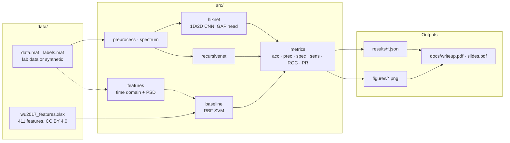
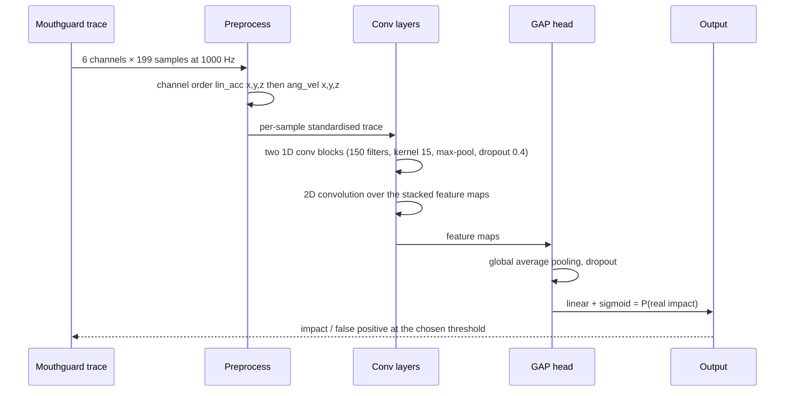

# HIKNet

**Separating real head impacts from chewing, biting and dropped mouthguards — a convolutional network on raw kinematic traces.**

[](requirements.txt)
[](src/hiknet.py)
[](src/baseline.py)
[](scripts/make_mock_data.py)
[](CONTRIBUTING.md)
[](LICENSE)

An instrumented mouthguard records linear acceleration and angular velocity
whenever it sees a spike above 10g. Many of those recordings are not real head
impacts: chewing, spitting, biting or dropping the mouthguard can trigger it
too. HIKNet, a 1D/2D convolutional network based on PerceptionNet, learns to
tell them apart, and is compared against an SVM on hand-picked features.

Reference: Fanton, Gaudio, Ling, *Neural Network for Detecting Head Impacts from
Kinematic Data*, CS229, Stanford. A UE24CS352A Machine Learning mini project.

---

## Contents

| Section | |
|---|---|
| [What it does](#what-it-does) | The models and experiments, by area |
| [Architecture](#architecture) | Data, features, models, reports |
| [How a sample is classified](#how-a-sample-is-classified) | Trace in, impact or not out |
| [Quick start](#quick-start) | Install, mock data, train, compare |
| [Results](#results) | HIKNet vs RecursiveNet vs SVM, with their limits |
| [Design decisions](#design-decisions) | The tradeoffs, and why |
| [Repository layout](#repository-layout) | Where things live |
| [Documentation](#documentation) | Which file answers which question |
| [Team](#team) | Who built it |

---

## What it does

| Area | Capabilities |
|---|---|
| **Data** | Loader for the Camarillo Lab `.mat` layout (527 × 199 × 6), shape and balance checks, time and frequency EDA |
| **Synthetic stand-in** | Same shape and class balance: damped 18–32 Hz impact pulses vs faster-ringing false positives with 80–200 Hz energy, 16 samples drawn from the opposite class |
| **HIKNet** | PerceptionNet-style 1D/2D CNN with a global-average-pooling head, early stopping, 0.36M parameters |
| **RecursiveNet** | The paper's second architecture, re-implemented for a 10-fold comparison |
| **Baseline** | RBF SVM on the Wu et al. (2017) released feature set, with forward feature selection |
| **Features** | Time-domain and PSD features from raw traces, for when the real data is available |
| **Tuning** | Head type, filter count, kernel width and dropout sweeps, 10 repeats each |
| **Reporting** | ROC and PR curves, a two-page write-up and slides generated from the result files |

### Dataset

- 527 samples: 264 real impacts, 263 false positives
- Each sample is 6 × 199: linear acceleration (x, y, z) and angular velocity (x, y, z) at 1000 Hz
- Real impacts sit mostly in the 20–30 Hz range; false positives carry more high-frequency content
- 70/30 train/eval split for the final model, 10-fold cross-validation for architecture selection

The lab data was never shared, so **every HIKNet number in this repo comes from
the synthetic stand-in**. The SVM baseline uses the feature set Wu et al. (2017)
released with their paper (Supplementary Dataset 1,
[Sci Rep 8:855](https://www.nature.com/articles/s41598-017-17864-3), CC BY 4.0):
411 features for 387 collegiate training samples and 32 youth test samples.

---

## Architecture



The dashed path computes the Wu et al. features from raw traces; the wavelet and
head-neck model features exist only in the released file.

---

## How a sample is classified



---

## Quick start

```bash
# 1 — environment
python -m venv .venv && source .venv/bin/activate   # Windows: .venv\Scripts\activate
pip install -r requirements.txt

# 2 — data: the real lab files, or the synthetic stand-in
python -m scripts.make_mock_data      # writes data/data.mat and data/labels.mat
python -m scripts.check_data          # shapes, class balance, channel ranges
python -m scripts.plot_eda            # time and frequency plots in figures/

# 3 — SVM baseline on the Wu et al. features
python -m scripts.select_features     # forward selection → results/selected_features.json
python -m scripts.train_svm           # 10-fold CV + youth test set → results/svm_metrics.json

# 4 — HIKNet and RecursiveNet (CPU is fine)
python -m scripts.train_hiknet        # 70/30 split, early stopping → checkpoints/hiknet.pt
python -m scripts.compare_models      # HIKNet vs RecursiveNet, 10-fold CV
python -m scripts.tune_head           # gap vs gmp vs dense head
python -m scripts.tune_hparams        # filters, kernel width, dropout → figures/tuning.png
python -m scripts.evaluate            # final HIKNet vs SVM table
python -m scripts.plot_curves         # ROC and PR curves
python -m scripts.demo -n 10          # classify a few random samples

# 5 — reports, generated from the result files
python -m scripts.make_writeup        # docs/writeup.pdf
python -m scripts.make_slides         # docs/slides.pdf
```

Real data goes in `data/` as `data.mat` (key `data`, shape (527, 199, 6)) and
`labels.mat` (key `label_impact_noimpact`, 1 = impact). `.mat` files are ignored
by git.

---

## Results

> [!NOTE]
> HIKNet numbers come from the **synthetic dataset**. They show the pipeline works,
> not how the model would do on real mouthguard data.

### HIKNet vs RecursiveNet — 10-fold CV, 30 epochs max

| Model | Accuracy | Precision | Specificity | Sensitivity | ROC AUC | PR AUC | Params |
|---|---:|---:|---:|---:|---:|---:|---:|
| **HIKNet** | 93.6% | 91.5% | 90.9% | 96.2% | 0.967 | 0.961 | 0.36M |
| RecursiveNet | 82.0% | 75.8% | 84.8% | 79.3% | 0.882 | 0.902 | 10.1M |

HIKNet wins on every metric with about **28× fewer parameters**; most of
RecursiveNet's sit in its dense layer.

### Tuning — mean ROC AUC over 10 repeats of a 70/30 split

| Knob | Finding |
|---|---|
| Head | Global average pooling 0.956, global max pooling 0.943, dense 0.717 (often fails to train) |
| Filters | 30–200 all within 0.950–0.956; 15 filters drops to 0.949 |
| Kernel width | 15 is clearly best (0.956); every other width has unstable runs |
| Dropout | 0–0.5 is flat (0.951–0.957); 0.6 starts to hurt |

The original settings — GAP head, 150 filters, kernel 15, dropout 0.4 — hold up.

### Final comparison — 30% eval split (n = 158)

| Model | Accuracy | Precision | Specificity | Sensitivity | ROC AUC | PR AUC |
|---|---:|---:|---:|---:|---:|---:|
| **HIKNet** | 89.9% | 89.9% | 89.9% | 89.9% | 0.950 | 0.923 |
| SVM (6 selected features) | 75.9% | 87.3% | 91.1% | 60.8% | 0.910 | 0.902 |

HIKNet early-stops on the same split it is scored on, so its numbers are a little
optimistic.

### SVM baseline on the real Wu et al. features

| | Accuracy | Precision | Specificity | Sensitivity | ROC AUC | PR AUC |
|---|---:|---:|---:|---:|---:|---:|
| Collegiate, 10-fold CV (n = 387) | 90.2% | 96.8% | 98.3% | 78.2% | 0.978 | 0.970 |
| Youth test set (n = 32) | 96.9% | 100% | 100% | 93.8% | 1.000 | 1.000 |

Wu et al. report 87.2% sensitivity and 93.2% precision with leave-one-out CV;
this uses 10-fold CV and default RBF settings, so the numbers differ a bit.

---

## Design decisions

**Learn from raw traces.** The point of HIKNet is to drop hand-engineered
features. The SVM baseline keeps them, so the comparison shows what the network
buys.

**A synthetic stand-in, labelled as one.** The lab data was never released.
Mock data with the same shape, class balance and frequency signature lets every
script run end to end, and every table built on it says so.

**Make the task not trivially separable.** Sixteen synthetic samples are drawn
from the opposite class, so a perfect score would be a red flag rather than a
result.

**Select architectures by cross-validation.** HIKNet vs RecursiveNet and every
tuning sweep use repeated splits; the single 70/30 eval split is reserved for the
final table.

**Reports are generated, not typed.** The write-up and slides read
`results/*.json` and `figures/`, so they cannot drift from the code.

---

## Repository layout

```
.
├── src/
│   ├── hiknet.py · recursivenet.py   the two networks
│   ├── baseline.py · features.py     RBF SVM and the feature extractors
│   ├── data.py · preprocess.py       loading and preprocessing
│   ├── spectrum.py · metrics.py      PSD and the six reported metrics
│   ├── train.py · tuning.py          training loop, early stopping, sweeps
│   └── mock.py                       the synthetic stand-in
├── scripts/       one entry point per step: data checks, EDA, training, tuning, evaluation, reports
├── data/          lab or synthetic .mat files (ignored), Wu et al. features
├── results/       metrics and scores as JSON
├── figures/       EDA, tuning, ROC and PR curves
├── docs/          write-up and slides
└── resources/     the authors' original code, report, poster, guidelines, Wu et al. (2017)
```

---

## Documentation

| Question | File |
|---|---|
| *What did we find, in two pages?* | [docs/writeup.pdf](docs/writeup.pdf) |
| *What was presented?* | [docs/slides.pdf](docs/slides.pdf) |
| *How was the work split into phases?* | [CONTRIBUTING.md](CONTRIBUTING.md) |
| *What did the original authors do?* | [resources/Project_Code_zip/](resources/Project_Code_zip/) |
| *Where did the SVM features come from?* | [resources/wu2017/](resources/wu2017/) |
| *What are the raw numbers?* | [results/](results/) |

---

## Team

| Member | Focus |
|---|---|
| **Guru R Bharadwaj** (PES1UG24CS177) | Solo project — data pipeline, models, baseline, tuning and reports |

---

## License

[MIT](LICENSE).
